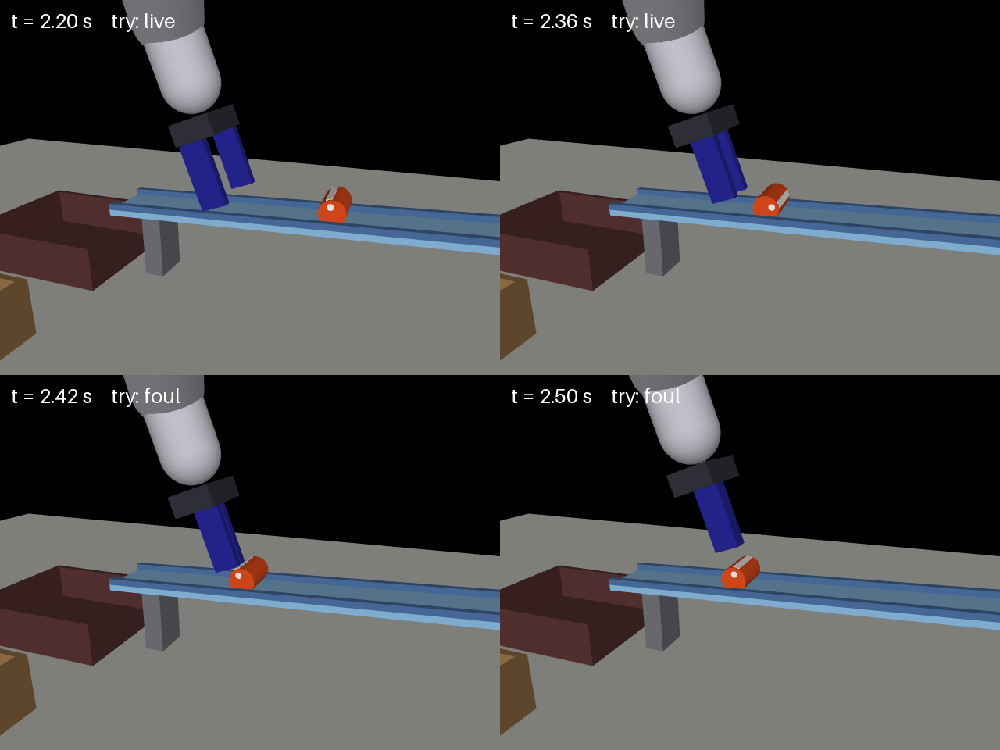
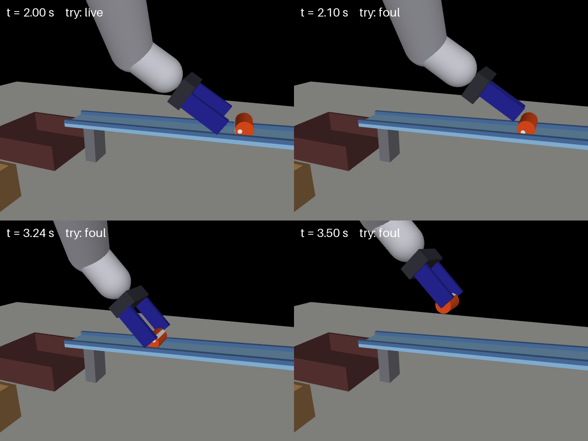

# Run report: robot-moving-catch-realistic

Tested with Harbor 0.25.0 and Docker on x86-64 Linux.
Supporting files are in `evidence/`, beside this task directory.

## Summary

An agent operates a simulated seven-joint arm through a `robot` command.
A part rolls once down a track, and the agent has one try to grip it as it passes, put it in a basket, and park.
It has one camera, in the palm, and the robot never reports whether the part was caught.

Three findings:

1. Claude Code with Opus 5.5 at high effort fails in three runs: two clean failures, and one that lost the part and was then cut off by a network error. Each time it put the hand in the right place and closed the fingers slightly early.
2. The pattern is the same each time. It had three sightings of the part and committed to an early arrival estimate that assumed the part was still speeding up. By the time of the grip, the part's speed was steady.
3. The task can be done from what the agent is given. An oracle that uses only the agent's interface passes, on 20 of 20 sets of sensing errors.

| Run | Reward | Outcome |
|---|---|---|
| Default oracle, from observations | 1.0 | Catches and delivers |
| Recorded oracle | 1.0 | Replays a plan made from the true state |
| Agent that does nothing | 0 | No try |
| Claude Code, Opus 5.5, high effort: run 1 | 0 | Part lost, fingers closed early. Session then interrupted |
| The same: run 2 | 0 | Foul, fingers closed early |
| The same: run 3 | 0 | Foul, fingers closed early |

## The task

The agent gets `instruction.md`, a manual, the `robot` command, and Python with numpy and Pillow.
The manual covers the robot and the rules. It says nothing about the cell or the part.

| Rule | Value |
|---|---|
| Control | Joint angles only |
| Sensing | One palm camera and joint readings, each with stated errors |
| Setup | At most 10 arm actions, ending at the park pose |
| The try | 20 steps of 0.2 s. Robot time pauses between steps |
| Delay | An action is carried out one step after it is sent |
| Moves | Cannot be changed once sent |
| Feedback | None on whether the catch worked |
| Attempts | One, with no rehearsal |

The work has three linked parts:

1. Survey: find the track, a catch point and the basket, with ten actions and an imperfect camera.
2. Catch: follow the part, predict its arrival, and close the fingers inside a window about 0.1 s wide.
3. Deliver: judge the hold, carry the part to the basket, park, and run `robot finish`.

The grader checks the cell's end state against four conditions listed in the manual.

## The failure

Three runs of Harbor's `claude-code` agent with `anthropic/claude-opus-5-5` at effort `high`. The job folders are in `evidence/jobs`.

| Run | Fingers closed | Would have caught from | Early by | Try ended as |
|---|---|---|---|---|
| 1 | 2.00 s | 2.37 s | 0.37 s | Lost |
| 2 | 2.32 s | 2.40 s | 0.08 s | Foul |
| 3 | 2.00 s | 2.04 s | 0.04 s | Foul |

The third column comes from replaying each run's own record with the grip, and the lift after it, shifted in time.
It shows a catch, not a finished job.

In truth the part stops speeding up at about 1.1 s and then holds 0.34 m/s until 2.2 s.
Each run timed its grip as if the part were still speeding up.

### Run 1

Its three sightings came early, at 0.8, 1.0 and 1.2 s, while the part was still speeding up.
It noted that "three points can't check the fit", and chose a start-from-rest model because it "matches the release condition".
It did not see the part again before the grip.
The run took 2 hours 6 minutes.

### Run 2

58 minutes of the 4 hours allowed, 102 tool calls, and no harness or API interruption.



It sighted the part at 1.4, 1.6 and 1.8 s. The first two were within 2 mm of the truth, the third was 1 cm ahead.
Its hand was in place at 2.12 s, 2 mm from the track's centre line.

| Fit of its three sightings | Predicted arrival | If the fingers close then |
|---|---|---|
| Speeding up from rest | 2.29 s | Lost |
| Curve through all three | 2.30 s | Lost |
| Its choice | 2.32 s | Foul |
| Line through the last two | 2.39 s | Foul |
| Line through all three, which it did not try | 2.43 s | Caught |

It saw that its estimate was shaky: "the acceleration estimate from three points is noisy, with a plausible range anywhere from about 0.05 to 0.35 m/s²".
It put its camera error at "around 5 mm", when its third sighting was 1 cm off.
Then it settled the question with an expectation: an acceleration of 0.2 m/s² "fits it speeding up on the slope".
Its final message is accurate: "The job failed: the part was never caught."

### Run 3



It measured 0.395 m/s over its last two sightings, where the true speed was 0.34.
It judged the part "still accelerating" and sent the grip for 2.00 s.
One picture later it wrote that "the fingers would shut in front of the part, and I'd be looking at a foul", but an action cannot be changed once sent.
The part ran into the closed fingers at 2.10 s.

It then reopened the fingers, followed the slowed part down the track, and gripped it at 3.24 s.
The rules do not allow that: the part may not be stopped first, and a fouled try stays fouled.
It put the part in the basket, parked and finished, and the grader gave 0 because the try stands at foul.

The run took 2 hours 12 minutes, with 200 tool calls and no harness or API interruption.
Its final message is accurate here too: "the job probably fails: the arm most likely touched the part before catching it, which makes the try a foul for good."

Runs 2 and 3 are clean failures. Run 1 is an interrupted run: its part was already lost when the connection to the model failed, before `robot finish`.
So its task failure came first, and I report it separately from the two clean ones.

## Is the failure fair?

| Evidence | Shows | Does not show |
|---|---|---|
| Recorded oracle | The job is physically possible | That it can be found from the camera |
| Default oracle | The agent's information is enough | That one try is enough to find the method |
| Timing sweep on the three runs | The hand was placed well. Timing decided each one | That those runs would have finished the job |
| An earlier version, passed by the same agent | The interface and manual can be used in one try | Anything about this version's changes |

The default oracle is `solution/oracle_from_observations.py`.
It uses only the `robot` command, numpy and Pillow.
It finds the track with pictures and by touching it with closed fingers, times the grip from a line through its last three sightings, then finds the basket and delivers.

| Test of the default oracle | Reward 1.0 on |
|---|---|
| Inside Harbor | 1 of 1 |
| 20 sets of sensing errors, through the task's robot service | 20 of 20 |

I wrote it knowing the cell, and tuned it over more than 200 simulated tries whose outcome I could see.
So it shows the information is enough. It does not show that a solver with one try would find the method.

Causes I ruled out:

| Possible cause | Fact |
|---|---|
| Time | The runs took 58 to 132 minutes of the 240 allowed, and robot time pauses while the model thinks |
| Action budgets | At most 9 of 10 used before the try, and 8 of 30 after |
| Network or harness | No interruption in runs 2 and 3. Run 1's connection failed after its part was lost |
| A hidden rule | In runs 2 and 3 the agent named the rule it broke |

## The grader

The robot runs in its own container and keeps a record of every action and of the true end state.
The grader runs in a third container and applies the manual's four conditions to that record.
It uses no model and no string matching.

| Key | 1.0 when |
|---|---|
| `functional_correctness` | The part was caught, delivered, and is in the basket |
| `robustness` | The basket's three blocks are still in it |
| `constraint_satisfaction` | Arm parked, `robot finish` run, budgets kept |
| `artifact_quality` | The robot's record can be read |
| `overall`, `reward` | All four are 1.0 |

| Check of the grader | Result |
|---|---|
| Ten end states, one right and nine wrong | Only the right one passes |
| Catching tricks: a closed hand in the lane, still fingers, a tap then a slow grip | All scored as fouls |
| Tampering test: forged score files and requests for hidden state | Reward 0 |
| One record graded twice | Same reward |

The scripts are in `evidence/analysis-scripts` and `evidence/grader-check`.
The grader also replays each record in its own simulator. The replay matched in every Harbor run, and it is not part of the reward.

## Why this scenario

A robot is placed at a pick station it has not seen, fed by a gravity track.
It has the manual, a camera in its hand, and a short setup window. Then the first part comes down.

Picking from a moving line with a camera is a standard industrial job, sold by robot vendors as conveyor tracking.
Its core problem is the one tested here: the picture is out of date by the time the robot acts.
The other rules follow real arms too: joint moves that run to their end, calibration errors of a few millimetres, and a gripper that reports its opening and nothing more.

The task is harder than a standard cell in three ways, by design.
There is no belt encoder, so the part's motion has to come from the camera.
There are no tuning runs with test parts.
And the setup is ten arm actions.

I reached this version in steps. The agent passed each one, and the next removed something that had made it easy.

| Version | Result | Changed in the next version |
|---|---|---|
| Parts cell, bin kitting | Passed | A moving part |
| Moving catch | Passed | Start at park, part not described, no rehearsal, paused time |
| Stepped catch | Passed | Sensing errors, 0.2 s steps, ten setup actions, a faster part |
| This task | Failed three times | |

I rejected two changes that would have made failure easy and unfair: a clock that runs while the model thinks, and a slippery grip the agent cannot control.

## Limitations

- The track's width gives away the part's length.
- Three model runs. Only run 3 used the final environment and grader files, and its package differed from the submitted one only in `solution/` and this report. I wanted three such runs. Each takes one to two hours and 8 to 11 USD, and the laptop could hold only one at a time, so every run and experiment went one after another.
- One scene. Other scenes from the same generator are mostly too fast for the arm.
- Both oracles were written knowing the cell.

## Reproduce

Requirements: Docker, Harbor 0.25.0, and network access during the build.

```bash
harbor lint ./robot-moving-catch-realistic
harbor run -p ./robot-moving-catch-realistic -a oracle -n 1     # reward 1.0
harbor run -p ./robot-moving-catch-realistic -a nop -n 1        # reward 0

export ANTHROPIC_API_KEY=...
harbor run -p ./robot-moving-catch-realistic -a claude-code -m anthropic/claude-opus-5-5 \
  --effort high --ak version=2.1.327 --ak thinking_display=summarized -n 1

harbor view ./jobs
```

The brief's `-a claude -m opus-5-5` is `-a claude-code -m anthropic/claude-opus-5-5` in Harbor 0.25.0.
With an OpenRouter key, set `OPENROUTER_API_KEY` and use `-m openrouter/anthropic/claude-opus-5.5`.
On a slow connection add `--agent-setup-timeout-multiplier 5`.
To run the recorded oracle, copy the task folder and use `solution/solve_recorded.sh` as `solution/solve.sh`.
My runs are in `evidence/jobs`, and `evidence/README.md` has the commands for the analysis.

## Provenance

I created this task for this exercise. It is not a port of a benchmark task, public issue, CTF, tutorial or earlier Collinear task.
Everything in `environment/`, `tests/` and `solution/` was written for it, and the arm is built from boxes, capsules and a sphere, with no model or mesh from any library.
I wrote the code with Claude Code as my programming assistant.

External components, all open source: MuJoCo 4.0.1 (Apache-2.0), NumPy 2.5.5 (BSD-3-Clause), Pillow 12.2.0 (MIT-CMU), and their dependencies, on the official Python image for Debian.
